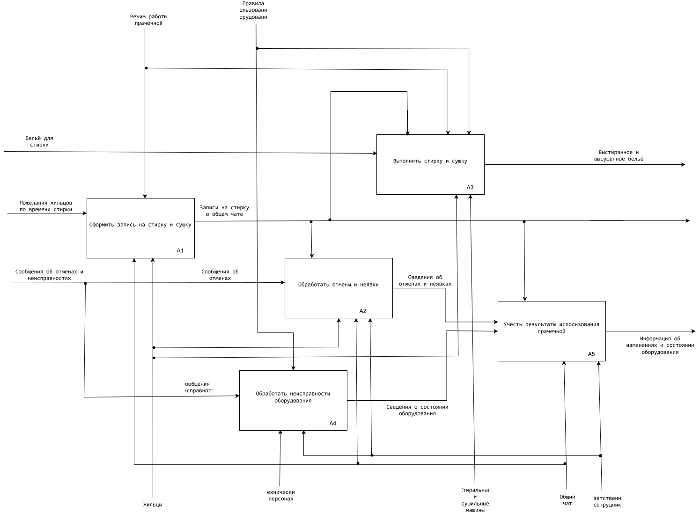
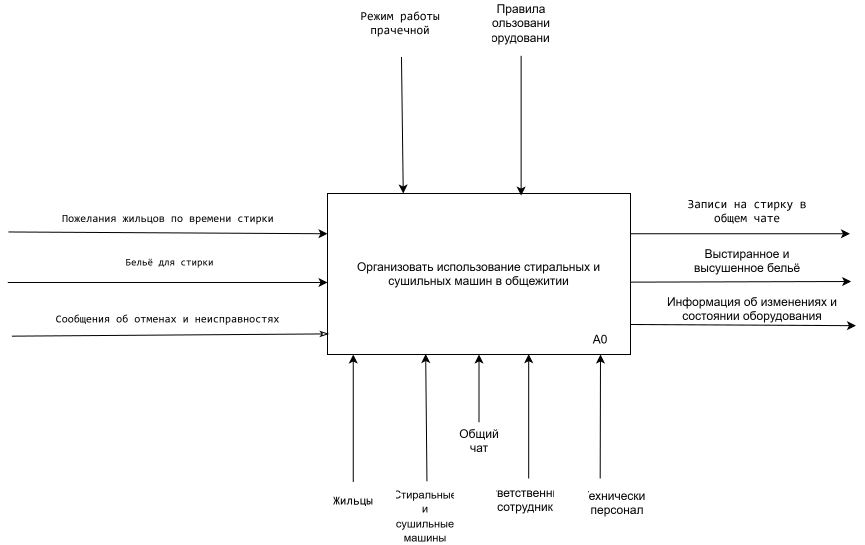
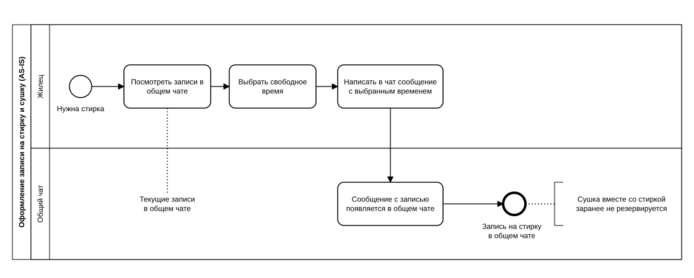
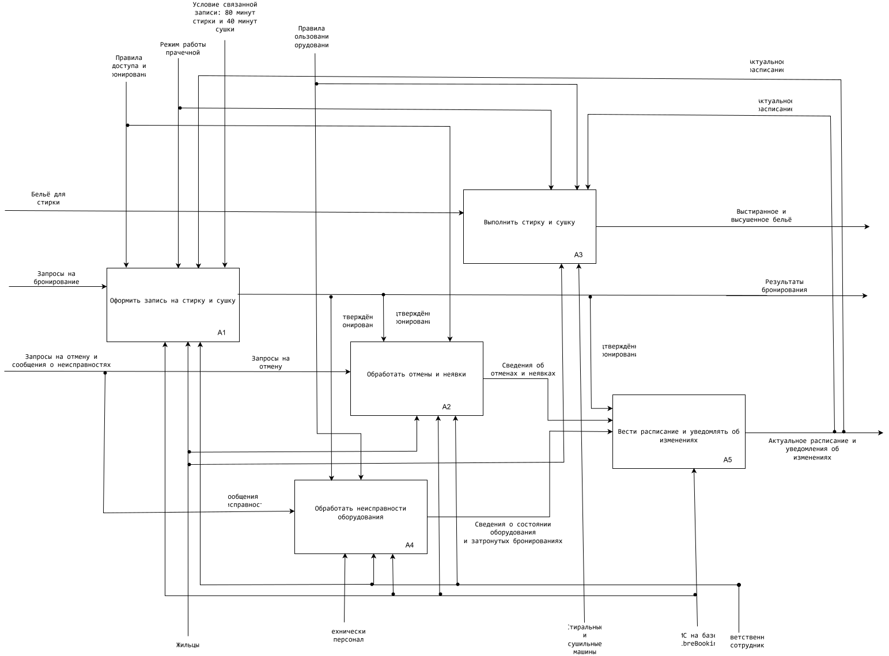
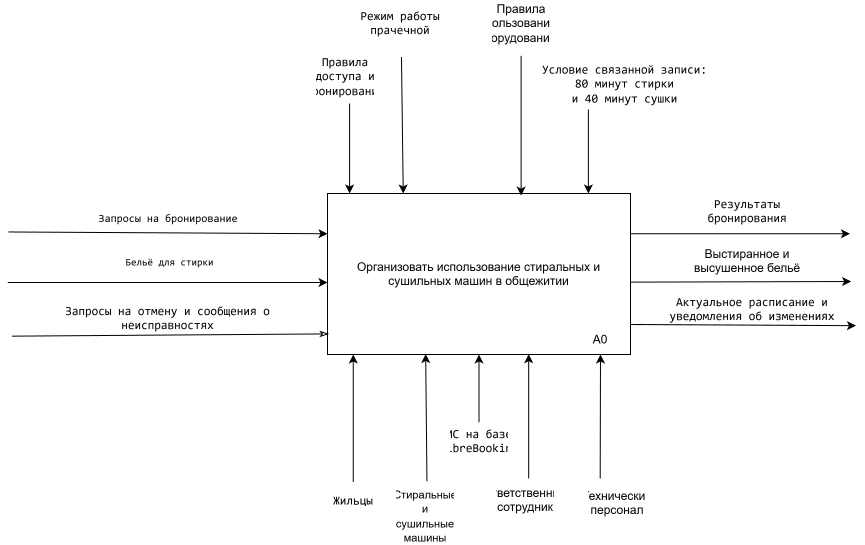

# laundry-dormitory
# Моделирование бизнес-процессов с учётом внедрения информационной системы

**Практическая работа №3**

**Дисциплина:** Проектирование информационных систем

**Тема:** Бронирование стиральных машин в общежитии

## Состав команды и распределение ролей

| Участник | Учебная группа | 
|---|---|
| Нгуен Динь Нам | K3340 |
| Субагио Сатрио Брахманторо Ади | K3340 | 
| Абакар Иссака Малли | К3341 | 

## Содержание

- [Цель работы](#цель-работы)
- [1. Объект моделирования и границы процесса](#1-объект-моделирования-и-границы-процесса)
- [2. Модель бизнес-процессов AS-IS](#2-модель-бизнес-процессов-as-is)
- [3. Модель бизнес-процессов TO-BE](#3-модель-бизнес-процессов-to-be)
- [4. Основные различия между AS-IS и TO-BE](#4-основные-различия-между-as-is-и-to-be)
- [5. Выводы](#5-выводы)

## Цель работы

Построить модели использования прачечной общежития до и после внедрения информационной системы и определить, как изменятся запись на стирку и сушку, обработка отмен и действия при неисправностях оборудования.

## 1. Объект моделирования и границы процесса

В общежитии проживают около 500 человек. В прачечной установлено 10 стиральных и 10 сушильных машин. Прачечная работает по будням с 07:30 до 21:30, по выходным — с 09:00 до 17:00.

В модели AS-IS жильцы записываются на стирку в общем чате. Обработка отмен и сообщений о неисправностях вручную принята в качестве допущения модели. В модели TO-BE используется выбранная в практической работе № 2 концепция на базе LibreBooking. Она предусматривает одну связанную запись на 80 минут стирки и следующие за ними 40 минут сушки.

Модели охватывают запись, отмены и неявки, использование машин, обработку неисправностей и обновление информации для жильцов. Жильцы самостоятельно стирают и сушат бельё. Ответственный сотрудник проверяет право на пользование прачечной и обрабатывает исключения, а технический персонал обслуживает и ремонтирует оборудование.

## 2. Модель бизнес-процессов AS-IS

### 2.1. Контекстная диаграмма IDEF0 (A-0)

Желаемое время стирки, бельё и сообщения об изменениях поступают на вход процесса. Режим работы и правила пользования оборудованием определяют условия его выполнения. Жильцы используют общий чат для записи, а затем самостоятельно стирают и сушат бельё.

### 2.2. Декомпозиция первого уровня (A0)

Процесс разделён на пять функций. Жильцы ориентируются на записи в чате при выборе времени стирки. Сведения об отменах, неявках и состоянии оборудования обрабатываются вручную и при необходимости сводятся ответственным сотрудником.

### 2.3. Декомпозиция A1 «Оформить запись на стирку и сушку» (BPMN)

Жилец просматривает записи в общем чате, выбирает свободное время и пишет сообщение. Результатом становится запись на стирку в общем чате. Время сушки вместе со стиркой заранее не резервируется.

### 2.4. Декомпозиция A4 «Обработать неисправности оборудования» (BPMN)

## 3. Модель бизнес-процессов TO-BE

### 3.1. Контекстная диаграмма IDEF0 (A-0)

Жильцы подают заявки через информационную систему на базе LibreBooking. Для подтверждения записи требуется доступная стиральная машина на 80 минут и доступная сушильная машина на следующие 40 минут. Оба интервала должны укладываться в режим работы прачечной. Система выдаёт результат бронирования, актуальное расписание и уведомления об изменениях.

### 3.2. Декомпозиция первого уровня (A0)

Функция A1 обрабатывает запросы на бронирование, используя актуальное расписание. Подтверждённые записи поступают в A5 вместе со сведениями об отменах, неявках и неисправностях. На основе этих данных A5 обновляет расписание и формирует уведомления. Расписание используется при обработке новых заявок и определяет время использования машин.

### 3.3. Декомпозиция A1 «Оформить запись на стирку и сушку» (BPMN)

.svg)

Жилец отправляет запрос на бронирование. Система проверяет право на бронирование, соответствие обоих интервалов режиму работы прачечной и доступность стиральной и сушильной машин. При успешной проверке подтверждается одна запись: 80 минут стирки и следующие 40 минут сушки, после чего она передаётся в A5. Если у жильца нет права на бронирование, система уведомляет его об этом, и процесс завершается. Если машины заняты или выбранные интервалы выходят за часы работы прачечной, жилец получает причину отказа и может выбрать другое время. Диаграмма заканчивается результатом бронирования.

### 3.4. Декомпозиция A4 «Обработать неисправности оборудования» (BPMN)

## 4. Основные различия между AS-IS и TO-BE

| Аспект | AS-IS | TO-BE |
|---|---|---|
| Запись на стирку | Жилец указывает время в общем чате. | Жилец подаёт запрос через систему и получает результат проверки. |
| Согласование стирки и сушки | Время сушки заранее не резервируется вместе со временем стирки. | В рамках одной записи резервируются 80 минут стирки и следующие 40 минут сушки. |
| Проверка доступности | Жильцы ориентируются на сообщения в чате. | Система проверяет оба интервала по актуальному расписанию перед подтверждением. |
| Отмены и неявки | Сведения об изменениях обрабатываются вручную. | При отмене освобождаются связанные интервалы. При неявке ответственный сотрудник проверяет фактическую доступность оборудования перед освобождением времени. |
| Неисправности | Сообщения и сведения о состоянии оборудования обрабатываются вручную. | Недоступность машины отражается в расписании. Определяются затронутые записи и формируются уведомления об изменениях. |
| Использование оборудования | Жильцы самостоятельно стирают и сушат бельё. | Жильцы самостоятельно пользуются машинами в соответствии с подтверждённой записью. |
