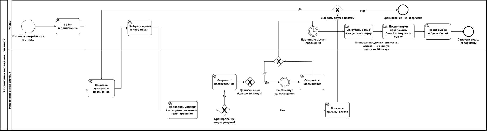

# Концепция информационной системы

**Практическая работа № 2**

**Дисциплина:** Проектирование информационных систем

**Тема:** Бронирование стиральных и сушильных машин в общежитии

## Состав команды и распределение ролей

| Участник | Учебная группа | Роль и основные обязанности |
|---|---|---|
| Нгуен Динь Нам | K3340 | Системный аналитик, координатор проекта: описание объекта и требований, моделирование процесса TO-BE, согласование разделов и итоговое оформление отчёта |
| Субагио Сатрио Брахманторо Ади | K3340 | Архитектор, аналитик: обзор готовых решений, разработка альтернативных вариантов, оценка ресурсов, затрат и рисков |

## Содержание

- [Цель и задачи работы](#цель-и-задачи-работы)
- [1. Характеристика объекта автоматизации и требования пользователя](#1-характеристика-объекта-автоматизации-и-требования-пользователя)
- [2. Аналитический обзор аналогов и готовых решений](#2-аналитический-обзор-аналогов-и-готовых-решений)
- [3. Альтернативные варианты концепции ИС](#3-альтернативные-варианты-концепции-ис)
- [4. Сравнение вариантов и обоснование выбора](#4-сравнение-вариантов-и-обоснование-выбора)
- [5. Описание выбранной концепции и модель процессов TO-BE](#5-описание-выбранной-концепции-и-модель-процессов-to-be)
- [6. Ожидаемые эффекты и технико-экономическое обоснование](#6-ожидаемые-эффекты-и-технико-экономическое-обоснование)
- [7. Реестр рисков и меры реагирования](#7-реестр-рисков-и-меры-реагирования)
- [8. Порядок оценки качества и условия приёмки](#8-порядок-оценки-качества-и-условия-приёмки)
- [9. Выводы](#9-выводы)
- [Список источников](#список-источников)

## Цель и задачи работы

**Цель работы** — разработать концепцию информационной системы бронирования стиральных и сушильных машин в общежитии и обосновать выбор подходящего варианта организации записи на стирку с учётом требований пользователей, затрат, ожидаемых эффектов и рисков.

Для достижения поставленной цели необходимо решить следующие задачи:

1. Описать объект автоматизации, участников и текущий процесс использования стиральных и сушильных машин. Определить основные проблемы, сформулировать функциональные и нефункциональные требования, ограничения и обязательные требования Must.

2. Провести аналитический обзор 3–5 аналогов или готовых решений, включая отечественные. Сравнить их по функциям, модели лицензирования, стоимости, возможностям интеграции и размещения данных.

3. Разработать не менее трёх альтернативных вариантов концепции, включая организационное решение без создания новой ИС. Для каждого варианта определить состав функций, технологическую основу, необходимые ресурсы, сроки, затраты, достоинства и недостатки.

4. Сопоставить варианты с требованиями пользователей. Согласовать с заказчиком критерии и веса, выполнить многокритериальную оценку, проверить устойчивость выбора и обосновать выбранный вариант.

5. Построить модель целевого процесса TO-BE в нотации BPMN 2.0. Показать изменения по сравнению с AS-IS и определить, какие действия автоматизируются, а какие остаются за пользователями и сотрудниками общежития.

6. Оценить экономическую целесообразность выбранного варианта: рассчитать совокупную стоимость владения за три года, годовой эффект, срок окупаемости и ROI. Определить 3–5 неденежных эффектов и показатели для их измерения.

7. Составить реестр из 7–10 рисков проекта, оценить их вероятность и влияние, выбрать стратегии реагирования, предложить конкретные меры и назначить ответственных.

8. Определить 5–7 измеримых показателей качества и порядок приёмки системы, включая виды испытаний, участников и итоговые документы.

9. Подготовить дорожную карту реализации выбранного варианта и оформить результаты анализа в виде отчёта с обоснованными выводами.

## 1. Характеристика объекта автоматизации и требования пользователя

### 1.1. Объект автоматизации

В работе мы рассматриваем организацию записи на стирку и сушку белья в общей прачечной общежития. Объектом автоматизации является процесс бронирования стиральных и сушильных машин, согласования времени их использования и управления расписанием.

В общежитии проживают около 500 человек. Прачечная оборудована 10 стиральными и 10 сушильными машинами. Основной сценарий предполагает последовательное использование двух машин: сначала жилец стирает бельё, затем переносит его в сушильную машину.

| Параметр | Значение |
|---|---|
| Число потенциальных пользователей | Около 500 человек |
| Количество стиральных машин | 10 |
| Количество сушильных машин | 10 |
| Продолжительность одного посещения | 2 часа: 80 минут на стирку и 40 минут на сушку |
| Время работы с понедельника по пятницу | 07:30–21:30 |
| Время работы в субботу и воскресенье | 09:00–17:00 |

Двухчасовой интервал относится ко всему посещению, а не к использованию каждой машины отдельно. Например, при начале в 07:30 стирка занимает интервал до 08:50, а сушка — с 08:50 до 09:30. При составлении расписания необходимо уточнить, входят ли загрузка, выгрузка и перенос белья в указанное время. Отдельный запас на эти действия в исходных данных пока не предусмотрен.

Для сравнения вариантов мы используем согласованные с заказчиком исходные условия и ограничения проекта.

| Параметр | Принятое значение |
|---|---|
| Расчётная одновременная нагрузка | До 50 пользователей |
| Бюджет создания и внедрения | Не более 600 тыс. руб. |
| Срок ввода в эксплуатацию | Не более 12 месяцев с начала проекта |
| Размещение данных | База персональных данных и её резервные копии размещаются на серверах в РФ |

Расчётная нагрузка составляет 10% от числа жильцов и используется при оценке производительности системы. Бюджет ограничивает затраты на создание и внедрение; эксплуатационные расходы учитываются отдельно. Для размещения системы рассматриваются инфраструктура вуза и арендуемые серверные ресурсы.

**Участники процесса:**

| Участник | Роль в процессе |
|---|---|
| Жилец общежития | Выбирает время, оформляет и отменяет запись, пользуется оборудованием и сообщает о неисправностях |
| Комендант или дежурный | Проверяет право на пользование прачечной, контролирует расписание и разрешает спорные ситуации |
| Технический персонал | Обслуживает и ремонтирует оборудование, сообщает о его недоступности и возвращении в работу |
| Администрация общежития или вуза | Утверждает правила пользования прачечной, ограничения проекта и порядок обработки персональных данных |

Проект охватывает организацию записи и обмен информацией о доступности оборудования. Загрузка белья, запуск программ, перенос вещей и освобождение машин остаются за жильцами, а ремонт — за техническим персоналом. Наличие записи в расписании само по себе не подтверждает фактическую работу машины.

### 1.2. Текущий процесс и проблемы AS-IS

Порядок записи в конкретном общежитии пока не обследован. Поэтому для первоначального анализа мы используем рабочую модель: жильцы записываются на бумаге, изменения обсуждают в общем чате, а спорные ситуации решают с дежурным. Эти предположения необходимо проверить при обсуждении процесса с жильцами и сотрудниками общежития.

В такой модели сведения о бронированиях, отменах и неисправностях обновляются вручную. При этом время стирки и последующей сушки не всегда согласуется заранее. На этой основе мы выделили семь потенциальных проблем.

| № | Проблема | Возможное последствие |
|---|---|---|
| П1 | Записи и изменения фиксируются в разных местах | Информация о свободном времени становится противоречивой или устаревает |
| П2 | Нет единого порядка проверки пересечений и ограничения числа записей | Несколько жильцов претендуют на одну машину одновременно, возникают споры |
| П3 | Не определён порядок действий при неявке или поздней отмене | Забронированное время остаётся неиспользованным, хотя другие жильцы готовы воспользоваться прачечной |
| П4 | Сведения о неисправностях не связаны с расписанием | Жильцы записываются на недоступное оборудование и узнают о проблеме только при посещении |
| П5 | Бронирования, отмены и неисправности не учитываются систематически | Администрации трудно оценить спрос и обосновать изменения режима работы или состава оборудования |
| П6 | Право на пользование прачечной не проверяется при записи | Возможны бронирования посторонними лицами или от имени другого жильца |
| П7 | Время использования стиральной и сушильной машин не согласовано | После стирки приходится ждать свободную сушильную машину; посещение может выйти за пределы рабочего времени |

### 1.3. Требования пользователя

Требования сформулированы с учётом потребностей жильцов и сотрудников общежития. Приоритет Must обозначает обязательное условие, Should — желательную возможность, Could — дополнительную функцию.

**Функциональные требования**

| ID | Требование | Приоритет | Связанные проблемы |
|---|---|---|---|
| R1 | Предоставлять актуальное расписание стиральных и сушильных машин с указанием свободных, занятых и недоступных интервалов | Must | П1, П4, П7 |
| R2 | Позволять жильцу оформить и отменить собственную запись с получением подтверждения результата; при отмене освобождать связанные интервалы стирки и сушки | Must | П1, П3 |
| R7 | Исключать подтверждение пересекающихся бронирований одной и той же машины, в том числе при одновременных обращениях | Must | П2 |
| R8 | Позволять ответственному сотруднику закрыть недоступное оборудование для записи, определить затронутые бронирования и организовать их отмену или перенос с уведомлением жильцов | Must | П4 |
| R10 | Проверять право жильца на пользование прачечной до подтверждения бронирования | Must | П6 |
| R14 | Подтверждать двухчасовую запись только при наличии стиральной машины на первые 80 минут и сушильной машины на следующие 40 минут; оба этапа должны завершаться в пределах рабочего времени | Must | П7 |
| R6 | Напоминать о предстоящем посещении прачечной | Should | П3 |
| R11 | Ограничивать количество предстоящих записей одного жильца в соответствии с согласованными правилами | Should | П2 |
| R12 | Позволять ответственному сотруднику фиксировать неявку и освобождать связанные интервалы после проверки фактической доступности оборудования; повторная запись допустима только при достаточном времени для её выполнения | Should | П3 |
| R9 | Предоставлять сводные данные о бронированиях, отменах, зафиксированных неявках и неисправностях по каждому виду оборудования | Could | П5 |

**Нефункциональные требования**

| ID | Требование | Приоритет |
|---|---|---|
| R3 | Просмотр расписания, оформление и отмена записи доступны через браузер мобильного телефона без установки отдельного приложения | Must |
| R5 | При нагрузке до 50 одновременных пользователей не менее 95% операций просмотра расписания, оформления и отмены записи завершаются в течение 2 секунд; условия измерения определяются в программе испытаний | Must |
| R13 | Жилец может управлять только собственными записями. Доступ к общему расписанию и персональным данным предоставляется сотрудникам в соответствии с их полномочиями; другим жильцам персональные данные не раскрываются | Must |

**Ограничения**

| ID | Ограничение | Приоритет |
|---|---|---|
| R4 | База персональных данных и её резервные копии размещаются на серверах на территории РФ | Must |
| R15 | Затраты на создание и внедрение не превышают 600 тыс. руб.; эксплуатационные расходы оцениваются отдельно | Must |
| R16 | Ввод в эксплуатацию осуществляется не позднее чем через 12 месяцев после начала проекта | Must |

## 2. Аналитический обзор аналогов и готовых решений

### 2.1. Сравнение аналогов

Для обзора мы выбрали пять решений, включая российские сервисы, специализированную платформу для прачечных и открытую систему бронирования ресурсов. Помимо общих возможностей записи, мы учитываем необходимость согласовать 80 минут стирки и следующие за ними 40 минут сушки.

| Аналог | Тип | Основные функции | Лицензирование / стоимость | Интеграции | Размещение данных |
|---|---|---|---|---|---|
| **Яндекс Формы + Яндекс Таблицы** | Российские облачные офисные сервисы | Сбор заявок, выгрузка ответов; ведение расписания сотрудником в таблице | Личные формы бесплатны; корпоративные возможности — по подписке. Пример: «Минимальный с Трекером» — 599 руб. за сотрудника в месяц | Почта, HTTP-запросы, экспорт XLSX и CSV | Для Яндекс 360 заявлено хранение данных в РФ |
| **YCLIENTS**  | Российский SaaS для онлайн-записи | Расписание, учёт оборудования как ресурсов, напоминания, последовательные комплексы услуг | Коммерческая лицензия на 4, 8 или 12 месяцев. Стоимость зависит от тарифной категории; для проекта нужен отдельный расчёт | API, виджет записи, готовые интеграции | Заявлены хранение и обработка персональных данных в РФ |
| **Битрикс24**  | Российская бизнес-платформа | Бронирование оборудования, проверка доступности ресурсов, напоминания, CRM | Коммерческая подписка. Ориентир для тарифа «Базовый» в опубликованном сравнении — 2 490 руб./мес.; достаточность тарифа требует проверки | REST API, вебхуки, приложения | Облако в РФ; коробочная версия размещается на сервере организации |
| **WeWash**  | Специализированный сервис для общих прачечных | Бронирование стиральных и сушильных машин, уведомления о завершении цикла, оплата и учёт использования | Коммерческий сервис. Стоимость подключения существующих машин через WeWash Box рассчитывается по запросу | API и интеграция с приложениями по условиям поставщика | Инфраструктура поставщика; размещение базы и резервных копий в РФ не подтверждено изученными материалами |
| **LibreBooking** | Открытая система бронирования ресурсов | Расписание, права доступа, квоты, отчёты, блокировка недоступного времени | GPL-3.0, без лицензионной платы. Необходимы ресурсы на настройку, сервер, сопровождение и возможные доработки | API, плагины, LDAP, Active Directory, календари | Сервер и место хранения резервных копий выбирает организация; возможно размещение в РФ |

Цены приведены как ориентиры без учёта временных акций. Они не включают все расходы на внедрение и эксплуатацию. Подходящий тариф и число оплачиваемых учётных записей определяются после выбора конфигурации.

### 2.2. Выводы обзора

Яндекс Формы и таблицы подходят для простой схемы, в которой сотрудник проверяет заявки и подтверждает запись. Предотвращение конфликтов в этом случае зависит от порядка работы. YCLIENTS и Битрикс24 предоставляют готовые инструменты бронирования ресурсов. В YCLIENTS документированы последовательные услуги с отдельными ресурсами для каждого этапа, поэтому мы рассматриваем его как возможную основу для схемы «80 + 40 минут».

WeWash наиболее близок к предметной области, но выполнение R4 пока не подтверждено. LibreBooking позволяет самостоятельно организовать размещение данных, однако поддержку единой записи на два последовательных этапа нужно проверить и при необходимости доработать. Таким образом, обзор определяет возможные основы решения, а окончательный выбор будет сделан после проверки требований Must и сравнения затрат, сроков и рисков.

## 3. Альтернативные варианты концепции ИС

### 3.1. Описание вариантов

На основе аналитического обзора мы разработали пять вариантов организации записи. Они различаются степенью автоматизации, способом размещения данных и объёмом необходимых изменений. Вариант A является организационным: новая информационная система не создаётся, а процесс упорядочивается с помощью регламента и существующих офисных инструментов.

| Параметр | A — организационный вариант | B — настройка YCLIENTS | C — настройка Битрикс24 | D — подключение WeWash | E — адаптация LibreBooking |
|---|---|---|---|---|---|
| **Идея решения** | Единая форма заявок, таблица расписания и регламент. Сотрудник проверяет возможность стирки и сушки, затем подтверждает запись | Настройка сервиса онлайн-записи и доступа жильцов через небольшой интеграционный модуль | Организация записи и обработки обращений на базе бизнес-платформы | Подключение существующих машин к специализированному сервису через WeWash Box | Размещение открытой системы на выбранном сервере и адаптация под правила общежития |
| **Автоматизируемые функции** | Сбор заявок, отправка сообщений и сводные расчёты. Проверка жильца, пересечений и подтверждение записи остаются ручными | Расписание, бронирование, отмена, напоминания и отчёты. Предусматривается настройка последовательных этапов и проверки права на запись | Расписание, бронирование ресурсов, уведомления, регистрация неисправностей и задачи ответственным сотрудникам. Последовательность «80 + 40 минут» требует отдельной настройки и проверки | Бронирование машин, уведомления и учёт циклов. Возможность заранее подтвердить оба последовательных этапа и ограничить доступ жильцами требует подтверждения поставщика | Бронирование, отмена, права доступа, квоты, отчёты и блокировка оборудования. Предусматривается доработка согласованной записи на стирку и сушку |
| **Архитектура и технологии** | Яндекс Формы, Яндекс Таблицы, уведомления по электронной почте. Жильцам доступно расписание без чужих персональных данных | Облачное ядро YCLIENTS, API и веб-модуль доступа на сервере в РФ. Учётная запись жильца активируется после проверки проживания | Облачный Битрикс24, ресурсы, CRM, задачи и REST API. Дополнительный веб-модуль обеспечивает доступ жильцов и необходимые правила записи | Устройства WeWash Box на оборудовании, приложение или веб-интерфейс, инфраструктура поставщика | LibreBooking, PHP, MySQL/MariaDB, веб-сервер в РФ. Дополнительный модуль связывает два этапа бронирования; резервные копии размещаются в РФ |
| **Команда** | 1 участник: описание процесса, настройка и обучение | 2 участника: аналитик-интегратор и разработчик; тестирование выполняется совместно | 2 участника: аналитик-настройщик платформы и разработчик интеграций | 1 координатор со стороны проекта и специалисты поставщика по подключению оборудования | 2 участника: разработчик серверной части и разработчик интерфейса; анализ и тестирование выполняются совместно |
| **Трудоёмкость** | 0,4 чел.-мес. — 64 часа | 2,0 чел.-мес. — 320 часов | 2,2 чел.-мес. — 352 часа | 1,0 чел.-мес. внутренних работ; труд поставщика определяется его предложением | 3,5 чел.-мес. — 560 часов |
| **Предварительный срок ввода** | 2 недели | 3 месяца | 4 месяца | 4–8 месяцев при подтверждении возможности поставки и подключения | 5 месяцев |
| **Достоинства** | Небольшие начальные затраты, простая настройка, понятный порядок работы | Готовое ядро записи, напоминания и поддержка поставщика | Совместное управление расписанием, обращениями и задачами сотрудников | Специализация на прачечных и связь сервиса с оборудованием | Контроль над размещением данных, доступ к исходному коду, отсутствие лицензионной платы |
| **Недостатки** | Постоянная ручная обработка, зависимость от доступности сотрудника, задержка подтверждения | Зависимость от тарифов и API; правила общежития могут потребовать интеграции и доработок | Более сложная настройка; часть функций платформы избыточна для одной прачечной | Не подтверждены размещение данных в РФ, стоимость и поддержка нужного сценария; подключение оборудования расширяет первоначальные границы проекта | Необходимы разработка, обновления и техническое сопровождение собственными силами |

Для вариантов B, C и E предполагается самостоятельная запись жильца после проверки его права на пользование прачечной. Способ проверки выбирается при проектировании: например, активация учётной записи ответственным сотрудником по списку проживающих. Интеграция с учётными записями вуза рассматривается как дополнительная возможность, если вуз предоставит необходимый доступ.

### 3.2. Обоснование оценок ресурсов

Для предварительного расчёта мы принимаем единые условия:

- один человеко-месяц составляет 160 рабочих часов;
- условная стоимость работы участника проекта — 80 тыс. руб. за человеко-месяц, или 500 руб./ч;
- стоимость времени сотрудника общежития — 400 руб./ч;
- резерв на непредвиденные затраты при внедрении — 15%;
- расчётный объём — 1 500 посещений в месяц, или 18 000 в год. Одно посещение включает стирку и сушку.

**Затраты на создание и внедрение**

Все суммы в таблице указаны в тысячах рублей.

| Вариант | Основные работы | Дополнительные затраты до запуска | Расчёт с резервом 15% | Итого |
|---|---|---|---|---|
| A | Настройка формы и таблицы, подготовка регламента, обучение: 0,4 × 80 = 32 | Подписка на период настройки и учебные материалы — 2 | (32 + 2) × 1,15 | **39,1** |
| B | Анализ, настройка YCLIENTS, модуль доступа, интеграция и тестирование: 2,0 × 80 = 160 | Подписка и тестовая инфраструктура до запуска — 20 | (160 + 20) × 1,15 | **207,0** |
| C | Настройка платформы, процессов и интеграций, тестирование: 2,2 × 80 = 176 | Подписка и тестовая инфраструктура до запуска — 20 | (176 + 20) × 1,15 | **225,4** |
| D | Обследование, согласование подключения и участие в приёмке: 1,0 × 80 = 80 | Оборудование и подключение по предложению поставщика — K | (80 + K) × 1,15 | **Зависит от K** |
| E | Анализ, адаптация LibreBooking, интерфейс, тестирование и внедрение: 3,5 × 80 = 280 | Тестовая инфраструктура и внешняя проверка безопасности — 20 | (280 + 20) × 1,15 | **345,0** |

Для варианта D величина K обозначает разовую стоимость оборудования и услуг поставщика в тысячах рублей. Чтобы общие затраты с резервом не превысили бюджет 600 тыс. руб., должно выполняться условие:

**K ≤ 600 / 1,15 − 80 ≈ 441,7 тыс. руб.**

Это допустимый предел предложения поставщика.

**Ежегодные затраты на эксплуатацию**

В расчёте мы разделяем подписки и техническое сопровождение, с одной стороны, и ручную работу сотрудника общежития — с другой. Это позволяет учитывать различия между вариантами по степени автоматизации.

Предварительно принимается следующее среднее время ручной обработки одного посещения:

- A — 2 минуты;
- B и C — 0,5 минуты;
- D — 0,5 минуты при реализации согласованного сценария обслуживания;
- E — 0,25 минуты после внедрения предусмотренных доработок.

Эти значения учитывают распределённое на все посещения время обработки заявок, отмен, переносов и исключительных ситуаций. 

| Вариант | Подписки, инфраструктура и техническое сопровождение, тыс. руб./год | Ручная работа сотрудника, ч/год | Стоимость ручной работы, тыс. руб./год | Всего, тыс. руб./год |
|---|---|---:|---:|---:|
| A | Две учётные записи: 599 × 2 × 12 / 1000 ≈ 14,4; техническая поддержка — 10. Итого **24,4** | 18 000 × 2 / 60 = **600** | **240,0** | **264,4** |
| B | Подписка: 5 × 12 = 60; инфраструктура модуля доступа — 15; сопровождение — 36. Итого **111,0** | **150** | **60,0** | **171,0** |
| C | Подписка и интеграции: 8 × 12 = 96; инфраструктура модуля доступа — 15; сопровождение — 36. Итого **147,0** | **150** | **60,0** | **207,0** |
| D | Ежегодная стоимость обслуживания по договору — O | **150** | **60,0** | **O + 60,0** |
| E | Сервер: 2 × 12 = 24; домен, почта и резервные копии — 6; сопровождение — 60. Итого **90,0** | **75** | **30,0** | **120,0** |

Для A предусмотрены две служебные учётные записи по тарифному ориентиру Яндекс 360; жильцы отправляют заявки через форму. Для B и C приняты плановые бюджеты на подписки — 5 и 8 тыс. руб. в месяц соответственно. Эти суммы, как и расходы на инфраструктуру и сопровождение, используются для учебного расчёта. Для D необходимо отдельное предложение поставщика с разовыми и ежегодными платежами.

Стоимость времени сотрудника отражает использование трудовых ресурсов и не обязательно означает дополнительные выплаты. В экономической оценке она учитывается отдельно от денежных расходов.

Расчётные затраты на создание и сроки внедрения A, B, C и E находятся в установленных пределах.

## 4. Сравнение вариантов и обоснование выбора

### 4.1. Соответствие требованиям

Мы рассматриваем пять вариантов организации бронирования:

- **A** — организационное решение на базе Яндекс Форм и Таблиц;
- **B** — настройка YCLIENTS;
- **C** — настройка Битрикс24;
- **D** — внедрение WeWash Box;
- **E** — адаптация LibreBooking.

Обязательные требования определяют допустимость каждого варианта. Преимущества по стоимости, срокам или дополнительным функциям не компенсируют невыполнение Must.

Матрица характеризует проектные решения. **П** — выполнение предусмотрено конфигурацией или доработкой; **Р** — ручное выполнение; **?** — соответствие не подтверждено; **—** — требование не выполняется.

| Требование | Приоритет | A | B | C | D | E |
|---|---|---|---|---|---|---|
| R1. Просмотр расписания машин | Must | Р | П | П | ? | П |
| R2. Бронирование и отмена связанных интервалов | Must | Р | П | П | ? | П |
| R3. Доступ через мобильный браузер | Must | П | П | П | П | П |
| R4. Персональные данные и резервные копии на серверах РФ | Must | ? | ? | ? | ? | П |
| R5. Не менее 95% основных операций за ≤ 2 с при 50 одновременных пользователях | Must | — | П | П | ? | П |
| R6. Напоминания о предстоящем посещении | Should | — | П | П | ? | П |
| R7. Предотвращение пересекающихся бронирований | Must | Р | П | П | ? | П |
| R8. Блокировка неисправных машин и обработка затронутых записей | Must | Р | П | П | ? | П |
| R9. Статистика бронирований, отмен и неисправностей | Could | П | П | П | П | П |
| R10. Проверка права жильца на бронирование | Must | Р | П | П | ? | П |
| R11. Ограничение количества предстоящих бронирований | Should | Р | П | П | ? | П |
| R12. Регистрация неявки и освобождение интервалов после проверки сотрудником | Should | Р | П | П | ? | П |
| R13. Разграничение доступа к данным | Must | П | П | П | ? | П |
| R14. Последовательное бронирование: 80 минут стирки и 40 минут сушки | Must | Р | П | П | ? | П |
| R15. Бюджет создания и внедрения ≤ 600 тыс. руб. | Must | П | П | П | ? | П |
| R16. Срок ввода в эксплуатацию ≤ 12 месяцев | Must | П | П | П | ? | П |

Вариант A служит организационной основой для сопоставления затрат и эффектов, но не участвует в рейтинге из-за несоответствия R5: сотрудник подтверждает каждую запись вручную.

Вариант D также не включён в рейтинг: имеющихся данных недостаточно для определения стоимости и подтверждения обязательных требований.

Для B, C и E мы сравниваем проектные конфигурации с предусмотренными настройками и доработками. Расчёт для B и C выполнен при условии подтверждения размещения основной базы и резервных копий в РФ. Пока выполнение R4 не подтверждено, эти варианты участвуют только в предварительном сравнении и не считаются прошедшими отбор по всем требованиям Must.

В конфигурации E выполнение R4 обеспечивается выбранным размещением базы и резервных копий на серверах в РФ. Производительность и корректность связанных бронирований проверяются при испытаниях..

### 4.2. Критерии и результаты предварительной оценки

Для сравнения вариантов мы используем шесть согласованных с заказчиком критериев и их веса. Наибольший вес имеет соответствие процессу «стирка — сушка» и правилам общежития. Стоимость оценивается за три года эксплуатации с учётом создания системы, технического сопровождения и трудозатрат сотрудника.

Остальные критерии характеризуют срок внедрения, управление доступом и данными, возможности интеграции и независимость от поставщика. Каждый вариант получает от 1 до 5 баллов: более высокий балл означает более предпочтительную оценку. Сумма весов равна единице.

| Критерий | Вес | B | C | E |
|---|---:|---:|---:|---:|
| Соответствие процессу стирки и сушки, гибкость правил | 0,25 | 4 | 3 | 4 |
| Стоимость владения за 3 года | 0,20 | 4 | 3 | 4 |
| Срок ввода в эксплуатацию | 0,15 | 4 | 3 | 3 |
| Управление доступом, данными и резервными копиями | 0,15 | 3 | 3 | 4 |
| Возможности интеграции и доработки | 0,15 | 4 | 4 | 4 |
| Независимость от поставщика | 0,10 | 2 | 2 | 4 |
| **Итоговая оценка Sᵢ** | **1,00** | **3,65** | **3,05** | **3,85** |

Расчётная стоимость владения включает создание системы, техническую эксплуатацию и стоимостную оценку времени сотрудника:

**TCO₃ = Cсозд + 3 × Cэкспл**, где Cсозд — стоимость создания системы, а Cэкспл — годовая стоимость эксплуатации.

| Показатель | B | C | E |
|---|---:|---:|---:|
| Стоимость создания, тыс. руб. | 207,0 | 225,4 | 345,0 |
| Годовая стоимость эксплуатации с учётом времени сотрудника, тыс. руб. | 171,0 | 207,0 | 120,0 |
| **TCO за 3 года, тыс. руб.** | **720,0** | **846,4** | **705,0** |
| Срок внедрения, месяцев | 3 | 4 | 5 |

Единые границы оценок позволяют сопоставить стоимость и срок внедрения всех вариантов.

| Балл | TCO за 3 года, тыс. руб. | Срок внедрения, месяцев |
|---:|---|---|
| 5 | До 600 включительно | До 1 включительно |
| 4 | Свыше 600 до 800 | Свыше 1 до 3 |
| 3 | Свыше 800 до 1 000 | Свыше 3 до 6 |
| 2 | Свыше 1 000 до 1 200 | Свыше 6 до 9 |
| 1 | Свыше 1 200 | Свыше 9 до 12 |

Качественные оценки отражают различия между проектными решениями. Вариант B предусматривает настройку последовательных услуг и интеграционного модуля. Для C разработчикам потребуется более сложная адаптация механизма бронирования ресурсов. В варианте E отдельный модуль обеспечивает связанное бронирование и позволяет изменять правила на уровне исходного кода.

Самостоятельное размещение E даёт обслуживающей команде контроль над данными и резервным копированием. При этом она отвечает за обновления и сопровождение системы. Поэтому независимость от поставщика оценивается в 4 балла, а не в 5.

Итоговая оценка представляет собой сумму произведений весов на соответствующие баллы:

**Sᵢ = w₁ × sᵢ₁ + w₂ × sᵢ₂ + … + w₆ × sᵢ₆**
где wⱼ — вес критерия, sᵢⱼ — оценка варианта i по критерию j.

Сумма весов равна единице:

**w₁ + w₂ + … + w₆ = 1.**

Для варианта E:

**S(E) = 0,25 × 4 + 0,20 × 4 + 0,15 × 3 + 0,15 × 4 + 0,15 × 4 + 0,10 × 4 = 3,85.**

### 4.3. Проверка устойчивости выбора

Для проверки устойчивости мы изменяем вес наиболее значимого критерия на ±0,05. Остальные веса пересчитываются пропорционально, чтобы их общая сумма оставалась равной единице:

**wⱼ′ = wⱼ × (1 − w₁′) / (1 − 0,25), j = 2, …, 6**,

| Вес критерия «Соответствие процессу и гибкость правил» | S(B) | S(C) | S(E) | Лидер |
|---|---:|---:|---:|---|
| 0,20 | 3,63 | 3,05 | 3,84 | E |
| 0,25 | 3,65 | 3,05 | 3,85 | E |
| 0,30 | 3,67 | 3,05 | 3,86 | E |

Вариант E сохраняет первое место во всех трёх сценариях. Выбор устойчив к указанному изменению весов.

Дополнительный расчёт показывает влияние стоимости рабочего времени сотрудника. Без её учёта трёхлетние затраты составляют 540 тыс. руб. для B и 615 тыс. руб. для E. Оценка стоимости B повышается до 5 баллов, а итоговые оценки B и E становятся равными — 3,85. Следовательно, преимущество E связано в том числе с сокращением ручного труда.

### 4.4. Обоснование выбора

Для дальнейшего проектирования мы выбираем **вариант E — адаптацию LibreBooking с модулем связанного бронирования стиральной и сушильной машин**.

В принятой расчётной модели он получает 3,85 балла и имеет наименьшую трёхлетнюю стоимость владения с учётом трудозатрат сотрудника — 705 тыс. руб. Стоимость создания составляет 345 тыс. руб., срок внедрения — 5 месяцев. Оба показателя находятся в установленных пределах.

Основные основания выбора — возможность изменения правил бронирования, контроль размещения данных и сокращение ручной обработки записей. **Вариант B — настройка YCLIENTS** остаётся резервным решением благодаря меньшим первоначальным затратам и более короткому сроку внедрения.

Выбор E относится к проектной конфигурации с предусмотренными доработками.

## 5. Описание выбранной концепции и модель процессов TO-BE

### 5.1. Концепция и архитектура системы

Мы предлагаем веб-систему на базе LibreBooking с модулем связанного бронирования стиральных и сушильных машин. Решение рассчитано на одну прачечную общежития с 10 стиральными и 10 сушильными машинами. Жильцы получают доступ через браузер телефона, а комендант управляет расписанием и обращениями через административный интерфейс.

Основу решения составляют веб-приложение на PHP, база данных MySQL и служба отправки уведомлений. Сервер приложения, база персональных данных и резервные копии размещаются в РФ. Дополнительный модуль связывает два этапа посещения и обеспечивает согласованное бронирование оборудования.

Одна запись включает два последовательных интервала:

- стиральная машина — первые 80 минут;
- сушильная машина — следующие 40 минут.

Например, при начале посещения в 07:30 система резервирует стиральную машину до 08:50, а сушильную — с 08:50 до 09:30. Отдельный технологический перерыв между этапами в двухчасовую модель не заложен.

Оба интервала образуют единую запись. Система подтверждает её только при доступности обеих машин и отсутствии пересечений. Если сохранить один из интервалов невозможно, бронирование целиком отклоняется.

Расписание учитывает часы работы прачечной: с 07:30 до 21:30 по будням и с 09:00 до 17:00 по выходным. Оба этапа должны завершаться до закрытия.

### 5.2. Организация целевого процесса

Перед первым бронированием комендант проверяет проживание пользователя в общежитии и активирует его учётную запись. После этого жилец самостоятельно выбирает время, оформляет запись и отменяет её при изменении планов.

| Этап | Действия участника и системы | Результат |
|---|---|---|
| 1. Вход и просмотр расписания | Жилец входит в систему и просматривает доступные интервалы. Интерфейс показывает занятость машин без персональных данных других пользователей | Пользователь видит доступные варианты посещения |
| 2. Выбор времени | Жилец выбирает начало посещения и доступную комбинацию стиральной и сушильной машин | Сформирован запрос на связанную запись |
| 3. Проверка и подтверждение | Система проверяет право бронирования, лимит записей, доступность машин, часы работы и отсутствие пересечений. Проверка и сохранение защищены от одновременной записи на одно время | Создана единая запись либо показана причина отказа |
| 4. Напоминание | Система отправляет уведомление за 30 минут до начала. При более позднем бронировании необходимую информацию содержит подтверждение записи | Жилец получает время посещения и номера машин |
| 5. Использование оборудования | Жилец загружает бельё, запускает стирку, переносит бельё в сушильную машину и освобождает её после завершения | Выполнен цикл стирки и сушки |
| 6. Учёт результатов | Система сохраняет историю бронирования и изменений. Сотрудник регистрирует подтверждённые неявки и неисправности | Доступны данные для контроля и статистики |

Истечение времени записи означает завершение запланированного интервала, но не подтверждает фактическое освобождение машины. Система не управляет оборудованием и не определяет его физическое состояние автоматически.

### 5.3. Модель процесса TO-BE

В BPMN-модели мы выделяем две дорожки: «Жилец» и «Информационная система». Диаграмма отражает основной сценарий бронирования и использования оборудования, включая отказ в записи, повторный выбор времени и отправку напоминания.

*Рисунок 1 — Основной сценарий бронирования и использования стиральной и сушильной машин.*

Сценарий предполагает исправность оборудования и явку жильца в назначенное время. Загрузка, запуск машин, перенос и выгрузка белья выполняются вручную. Продолжительность стирки составляет 80 минут, сушки — 40 минут.

| Сценарий | Последовательность действий | Результат |
|---|---|---|
| Основной процесс | Жилец выбирает время → система проверяет условия и создаёт связанную запись → отправляет подтверждение и напоминание → жилец выполняет стирку и сушку | Посещение завершено |
| Отказ в бронировании | Система обнаруживает нарушение условий → показывает причину → жилец выбирает другой интервал или завершает оформление | Новая запись не создаётся |
| Отмена до начала посещения | Жилец отменяет запись → система освобождает оба связанных интервала и отправляет подтверждение | Расписание обновлено |
| Неявка | Дежурный проверяет отсутствие жильца и фактическую доступность оборудования → регистрирует неявку → система отменяет оставшиеся интервалы записи | Свободное время возвращено в расписание |
| Неисправность | Жилец сообщает о проблеме → дежурный проверяет сообщение и блокирует машину → система определяет затронутые записи → комендант организует перенос или отмену и ремонт | Пользователи уведомлены, неисправная машина недоступна для новых записей |
| Возврат машины в работу | Технический персонал подтверждает исправность → комендант снимает блокировку | Машина снова доступна для бронирования |

Отсутствие отметки пользователя о начале стирки не считается подтверждением неявки. Дежурный освобождает запись только после проверки оборудования. Новое бронирование допускается, если система может выделить полные 80 минут стирки и 40 минут сушки без пересечения с другими записями.

При неисправности одной машины система учитывает связь между двумя этапами посещения. Если запись ещё не началась, перенос или отмена охватывает всю пару интервалов. Если стирка уже идёт, комендант согласовывает дальнейшие действия с жильцом с учётом фактического состояния оборудования.

### 5.4. Изменения по сравнению с AS-IS

Целевой процесс объединяет расписание, правила бронирования и обработку изменений. Основные изменения направлены на сокращение ручных операций и согласованное использование стиральных и сушильных машин.

| Проблема | Изменение в TO-BE | Ожидаемый результат |
|---|---|---|
| П1. Разрозненная и неактуальная информация | Система ведёт единое расписание и обновляет его после подтверждённых изменений | Жильцы получают сведения о доступном времени без обращения к сотруднику |
| П2. Пересечения записей и неясные ограничения | Система проверяет конфликты и применяет единые лимиты бронирования | Сокращается количество спорных ситуаций |
| П3. Неявки и поздние отмены | Жильцы получают напоминания и могут отменять записи; дежурный регистрирует неявки после проверки | Освободившееся время становится доступным для повторной записи |
| П4. Неисправности не связаны с расписанием | Блокировка машины запрещает новые бронирования и позволяет выявить затронутые записи | Жильцы получают уведомления об изменениях |
| П5. Отсутствие систематического учёта | Система сохраняет сведения о записях, отменах, зарегистрированных неявках и неисправностях | Администрация получает данные для оценки работы прачечной |
| П6. Отсутствие проверки проживания | Комендант подтверждает право пользователя, а система проверяет его при бронировании | Доступ к записи получают проживающие в общежитии |
| П7. Несогласованное использование стиральных и сушильных машин | Одна запись объединяет два последовательных интервала | Жилец заранее получает согласованное время для обоих этапов |

Статистика занятости отражает забронированное время. Для оценки фактической загрузки оборудования необходимы дополнительные наблюдения или технические средства учёта.

### 5.5. Границы системы

Мы ограничиваем автоматизацию организацией записи и информационной поддержкой работы прачечной. Система обрабатывает бронирования и изменения расписания, а жильцы и сотрудники выполняют физические действия с оборудованием.

| Процесс | Действия системы | Действия человека |
|---|---|---|
| Предоставление доступа | Хранение учётной записи, применение прав | Комендант проверяет проживание и активирует доступ |
| Бронирование | Проверка условий, сохранение связанных интервалов, подтверждение | Жилец выбирает время и машины |
| Отмена | Отмена связанных интервалов и обновление расписания | Жилец инициирует отмену |
| Напоминания | Отправка уведомлений по действующим записям | Жилец знакомится с сообщением |
| Обработка неявки | Изменение статуса и освобождение интервалов после решения сотрудника | Дежурный проверяет отсутствие жильца и доступность машин |
| Обработка неисправности | Регистрация обращения, блокировка расписания, поиск затронутых записей и отправка уведомлений | Сотрудник проверяет сообщение, принимает решение и организует ремонт |
| Использование и ремонт оборудования | Информационная поддержка | Жилец использует машины; технический персонал обслуживает и ремонтирует их |
| Разрешение споров | Предоставление истории изменений | Комендант рассматривает ситуацию и принимает решение |

Дистанционный запуск машин, управление дверцами, приём платежей и получение показаний датчиков в состав решения не входят.

### 5.6. Дорожная карта реализации

Мы планируем внедрение системы в течение пяти месяцев. Работы включают настройку LibreBooking, разработку дополнительных функций, испытания и опытную эксплуатацию.

| Этап | Срок | Основные работы | Результат |
|---|---|---|---|
| 1. Подготовка | Месяц 1 | Уточнение регламента, подготовка ТЗ, выбор размещения данных, проверка технической реализуемости связанных записей | Согласованные правила, ТЗ и техническое решение |
| 2. Настройка платформы | Месяц 2 | Развёртывание LibreBooking, создание перечня машин, настройка расписания, ролей и доступа жильцов | Рабочая базовая конфигурация |
| 3. Разработка дополнительных функций | Месяц 3 | Связанное бронирование и отмена, обработка неисправностей и неявок, напоминания | Версия с основными сценариями обслуживания |
| 4. Испытания | Месяц 4 | Проверка функциональности, одновременных запросов, нагрузки, прав доступа и восстановления из резервной копии; исправление ошибок | Версия для опытной эксплуатации |
| 5. Опытная эксплуатация и приёмка | Месяц 5 | Четырёхнедельный пилот, обучение пользователей и сотрудников, устранение замечаний, приёмочные испытания | Акт приёмки, инструкции и регламент сопровождения |
| 6. Сопровождение | После ввода в эксплуатацию | Обновления, резервное копирование, техническая поддержка и контроль KPI | Поддержание работоспособности и оценка результатов |

## 6. Ожидаемые эффекты и технико-экономическое обоснование

### 6.1. Исходные данные

Мы оцениваем экономическую целесообразность адаптации LibreBooking относительно сохранения ручного порядка записи. Оба сценария предусматривают одинаковое количество посещений прачечной.

Горизонт оценки составляет три полных года эксплуатации после внедрения. Цены принимаются постоянными, дисконтирование не применяется.

| Параметр | Значение |
|---|---:|
| Количество посещений в месяц | 1 500 |
| Количество посещений в год | 18 000 |
| Среднее время сотрудника на одно посещение при ручной организации | 2 минуты |
| Среднее время сотрудника на одно посещение после внедрения | 0,25 минуты |
| Стоимость часа работы сотрудника | 400 руб. |
| Стоимость создания и внедрения | 345 тыс. руб. |
| Годовые расходы на техническую эксплуатацию | 90 тыс. руб. |
| Срок внедрения | 5 месяцев |

Одно посещение включает стирку и сушку. Среднее время сотрудника учитывает обработку записей, отмен, обращений и подтверждённых неявок в расчёте на одно посещение. Значение 0,25 минуты характеризует среднюю трудоёмкость.

### 6.2. Годовой эффект

Основной измеримый эффект связан с сокращением ручной обработки записей. Жильцы самостоятельно выбирают время и отменяют бронирования, а система проверяет доступность машин и применяет правила записи.

| Показатель | Расчёт | Результат |
|---|---|---:|
| Трудозатраты при ручной организации | 18 000 × 2 / 60 | 600 ч/год |
| Трудозатраты после внедрения | 18 000 × 0,25 / 60 | 75 ч/год |
| Высвобождаемое рабочее время | 600 − 75 | 525 ч/год |
| Стоимостная оценка высвобождаемого времени | 525 × 400 | 210 тыс. руб./год |
| Техническая эксплуатация | Хостинг, дополнительные сервисы и сопровождение | 90 тыс. руб./год |
| **Чистый годовой эффект** | **210 − 90** | **120 тыс. руб./год** |

**Eчист = Eвремя − Cтех = 210 − 90 = 120 тыс. руб./год.**

Высвобождение 525 часов позволяет перераспределить рабочее время сотрудника на другие обязанности. При сохранении штатной численности и оплаты труда эта величина не означает сокращения выплат заработной платы.

Экономию времени жильцов мы учитываем как неденежный эффект. Доходы от дополнительных посещений и снижение расходов на ремонт в расчёт не включаются, поскольку для их оценки отсутствуют исходные данные.

### 6.3. Стоимость владения, окупаемость и ROI

Годовые расходы на техническую эксплуатацию составляют:

| Статья | Сумма, тыс. руб./год |
|---|---:|
| Хостинг | 24 |
| Домен, почтовый сервис и резервное копирование | 6 |
| Техническое сопровождение | 60 |
| **Итого** | **90** |

Оставшаяся работа сотрудника оценивается в 75 × 400 = 30 тыс. руб. в год. Полная годовая стоимость эксплуатации с учётом трудозатрат составляет 120 тыс. руб.

**TCO₃ = Cсозд + 3 × (Cтех + Cтруд).**

**TCO₃ = 345 + 3 × (90 + 30) = 705 тыс. руб.**

| Статья затрат | До запуска | Год 1 | Год 2 | Год 3 | Всего, тыс. руб. |
|---|---:|---:|---:|---:|---:|
| Создание и внедрение | 345 | 0 | 0 | 0 | 345 |
| Техническая эксплуатация | 0 | 90 | 90 | 90 | 270 |
| Работа сотрудника | 0 | 30 | 30 | 30 | 90 |
| **Итого** | **345** | **120** | **120** | **120** | **705** |

При сохранении ручного порядка записи сотрудник затрачивает 600 часов в год. Стоимость этой работы составляет 600 × 400 = 240 тыс. руб. в год, или 720 тыс. руб. за три года.

Для расчёта ROI мы принимаем 240 тыс. руб. в год за валовой эффект замещения ручного процесса. Оставшиеся трудозатраты сотрудника стоимостью 30 тыс. руб. в год включены в TCO вместе с техническими расходами. Таким образом, каждый вид затрат учитывается один раз.

**Эффект за 3 года = 3 × 240 − 705 = 15 тыс. руб.**

**ROI₃ = (3 × Eвал − TCO₃) / TCO₃ × 100%.**

**ROI₃ = (3 × 240 − 705) / 705 × 100% ≈ 2,1%.**

Чистый годовой эффект равен разнице между стоимостью замещаемой ручной работы и ежегодными расходами после внедрения:

**Eчист = 240 − (90 + 30) = 120 тыс. руб./год.**

Простой срок окупаемости составляет:

**Tок = Cсозд / Eчист = 345 / 120 ≈ 2,88 года.**

Это около 34,5 месяца эксплуатации или 39,5 месяца от начала проекта с учётом пятимесячного внедрения.

Полученные ROI и срок окупаемости характеризуют эффективность использования ресурсов с денежной оценкой рабочего времени. Затраты на создание и техническую эксплуатацию составляют 615 тыс. руб. за три года. Модель не предусматривает дополнительных денежных поступлений или сокращения фонда оплаты труда, поэтому прямой денежной окупаемости в принятом расчёте нет.

### 6.4. Чувствительность результата

Экономический результат зависит от объёма ручной работы, сохраняющейся после внедрения. Для проверки мы изменяем среднее время сотрудника на одно посещение, сохраняя годовой объём в 18 000 посещений и расходы на техническую эксплуатацию в 90 тыс. руб.

| Время сотрудника на посещение | Трудозатраты после внедрения, ч/год | Чистый годовой эффект, тыс. руб. | TCO₃, тыс. руб. | Окупаемость, лет эксплуатации | ROI₃ |
|---|---:|---:|---:|---:|---:|
| 0,25 минуты | 75 | 120 | 705 | 2,88 | 2,1% |
| 0,50 минуты | 150 | 90 | 795 | 3,83 | −9,4% |
| 0,75 минуты | 225 | 60 | 885 | 5,75 | −18,6% |

Для окупаемости за три года чистый годовой эффект должен составлять не менее:

**Eчист,min = 345 / 3 = 115 тыс. руб./год.**

Базовый результат превышает этот уровень только на 5 тыс. руб. в год. Экономическое преимущество невелико и чувствительно к трудоёмкости обслуживания. Во время опытной эксплуатации необходимо измерять время обработки обращений и корректировать расчёт по фактическим данным.

### 6.5. Неденежные эффекты и KPI

Помимо высвобождения рабочего времени, система улучшает доступность услуги и управляемость процесса. Для оценки этих изменений установлены пять показателей.

| Эффект | KPI | Целевое значение | Способ измерения |
|---|---|---|---|
| Удобство самостоятельной записи | Время оформления связанного бронирования авторизованным пользователем | Не более 1 минуты минимум в 90% проверенных сценариев | Пользовательское тестирование с участием не менее 30 жильцов |
| Отсутствие конфликтующих записей | Количество подтверждённых бронирований с пересечением времени на одной машине | 0 | Проверка базы записей и испытания одновременных запросов |
| Снижение неявок | Доля посещений с неявкой, подтверждённой сотрудником | Не более 10% | Сопоставление подтверждённых неявок и записей, срок начала которых наступил; предварительно отменённые записи исключаются |
| Своевременное информирование о неисправностях | Доля затронутых записей, по которым уведомление отправлено в течение 5 минут после блокировки машины | Не менее 95% | Журнал блокировок и отправки уведомлений |
| Удовлетворённость жильцов | Средняя оценка удобства сервиса по пятибалльной шкале | Не менее 4 баллов | Опрос не менее 30 пользователей |

Долю неявок и удовлетворённость пользователей оцениваем после трёх месяцев эксплуатации.

## 7. Реестр рисков и меры реагирования

### 7.1. Подход к оценке

Мы оцениваем риски по вероятности возникновения P и влиянию на проект I. Оба показателя принимают значения от 1 до 5: для вероятности 1 означает маловероятное событие, 5 — весьма вероятное; для влияния 1 соответствует незначительным последствиям, 5 — критическим нарушениям работы или требований проекта.

**Уровень риска: R = P × I.**

- **Низкий:** 1–7.
- **Средний:** 8–14.
- **Высокий:** 15–25.

Оценки отражают экспертное мнение команды до применения мер реагирования. Для каждого риска определены стратегия, конкретные действия и ответственная роль.

### 7.2. Реестр рисков

| № | Риск | Категория | P | I | R | Уровень | Стратегия | Меры реагирования | Ответственный |
|---|---|---|---:|---:|---:|---|---|---|---|
| 1 | Пересечение бронирований или сохранение только одного из двух связанных интервалов | Технический | 3 | 5 | 15 | Высокий | Снизить | Сохранять оба интервала как единую операцию; отменять изменения при ошибке; проверять одновременные запросы, отмену и перенос связанных записей | Ответственный разработчик |
| 2 | Недоступность системы или потеря данных | Технический | 2 | 5 | 10 | Средний | Снизить | Контролировать доступность сервера; ежедневно создавать резервные копии; проверять восстановление; предусмотреть единый временный журнал на период сбоя | Ответственный за эксплуатацию |
| 3 | Несанкционированный доступ к персональным данным или административным функциям | Информационная безопасность | 3 | 5 | 15 | Высокий | Снизить | Разграничить права; использовать защищённое соединение; проверить хранение паролей и доступ к чужим записям; регистрировать административные действия | Ответственный разработчик |
| 4 | Обработка персональных данных без согласованного порядка или размещение данных вне установленной территории | Правовой | 2 | 5 | 10 | Средний | Избежать | До загрузки реальных данных согласовать с вузом состав, основания и сроки обработки, права доступа и порядок удаления; подтвердить размещение основной базы и резервных копий в РФ | Представитель администрации общежития |
| 5 | Жильцы продолжают записываться вне системы, из-за чего возникают параллельные расписания | Организационный | 3 | 4 | 12 | Средний | Снизить | Установить единый порядок записи; подготовить краткую инструкцию; помочь с первым бронированием; обращения к дежурному также фиксировать в общей системе | Комендант |
| 6 | Ручная обработка обращений занимает больше времени, чем предусмотрено экономической моделью | Финансовый / организационный | 4 | 4 | 16 | Высокий | Снизить | Измерять трудозатраты во время пилота; выявлять повторяющиеся обращения; улучшать интерфейс и правила; пересчитывать TCO, годовой эффект и ROI по результатам наблюдений | Руководитель проекта |
| 7 | Превышение бюджета или срока внедрения | Финансовый / организационный | 3 | 4 | 12 | Средний | Снизить | Контролировать затраты и готовность функций; использовать резерв 45 тыс. руб., включённый в стоимость создания; в первую очередь реализовать Must; согласовывать изменения объёма работ | Руководитель проекта |
| 8 | Выбытие участника команды или отсутствие доступа к результатам его работы | Организационный | 3 | 5 | 15 | Высокий | Снизить | Хранить код и документацию в общем репозитории; проводить взаимное ревью; документировать развёртывание и восстановление; обеспечить обоим участникам необходимые проектные доступы | Руководитель проекта |
| 9 | Обновление LibreBooking нарушает работу дополнительного модуля | Технический | 3 | 4 | 12 | Средний | Снизить | Проверять обновления в тестовой среде; повторять проверки связанных бронирований; сохранять резервную копию перед обновлением; подготовить возврат к предыдущей версии | Ответственный разработчик |
| 10 | Расписание показывает свободный интервал, хотя машина фактически занята или неисправна | Эксплуатационный / организационный | 3 | 4 | 12 | Средний | Снизить | Освобождать запись при неявке только после проверки сотрудником; оперативно блокировать неисправные машины; снимать блокировку после подтверждения исправности | Комендант |

### 7.3. План действий по рискам высокого уровня

Для рисков 1, 3, 6 и 8 мы определяем признаки возникновения и порядок действий. Эти меры дополняют профилактику и применяются при обнаружении проблемы.

| Риск | Признак возникновения | Действия при наступлении |
|---|---|---|
| 1. Ошибка связанного бронирования | Обнаружены пересекающиеся подтверждённые записи или запись только на один этап | Приостановить создание новых записей для затронутых машин; проверить историю операций; согласовать перенос конфликтующих посещений; исправить причину и повторить испытания перед возобновлением записи |
| 3. Несанкционированный доступ | Выявлен доступ к чужим данным или действия без необходимых прав | Ограничить доступ затронутых учётных записей, завершить их сеансы и сохранить журналы; передать информацию ответственному за персональные данные вуза; устранить причину и проверить права перед восстановлением доступа |
| 6. Недостаточный экономический эффект | Средние трудозатраты превышают расчётные 0,25 минуты на посещение или чистый годовой эффект становится ниже 115 тыс. руб. | Определить основные причины ручной работы; скорректировать интерфейс, инструкции и обработку обращений; повторно измерить трудозатраты; обновить экономическую оценку и согласовать дальнейший объём внедрения |
| 8. Выбытие участника | Участник прекращает работу или не может выполнить закреплённые задачи в установленный срок | Проверить доступность кода и документации; перераспределить задачи; обновить календарный план; отложить необязательные функции, сохранив выполнение Must |

При недоступности системы онлайн-бронирование приостанавливается. Дежурный ведёт единственный временный журнал и подтверждает новые записи только после проверки существующих бронирований и доступности оборудования. Перед восстановлением онлайн-записи сотрудник сверяет временный журнал с базой, чтобы исключить пересечения.

### 7.4. Контроль рисков

Руководитель проекта пересматривает реестр еженедельно во время внедрения, ежемесячно при эксплуатации, а также после инцидентов или существенных изменений проекта. Ответственные фиксируют выполненные меры, результаты проверок и обновлённые оценки вероятности и влияния.

## 8. Порядок оценки качества и условия приёмки

### 8.1. Показатели качества

Мы оцениваем качество системы по корректности бронирования, производительности, защите доступа, надёжности и удобству использования. Испытания охватывают обычные действия пользователей, одновременные запросы и обработку ошибок.

| № | Показатель | Целевое значение | Способ проверки |
|---|---|---|---|
| 1 | Время оформления связанного бронирования | Не более 1 минуты минимум в 90% проверенных сценариев | Хронометраж от открытия расписания авторизованным пользователем до получения подтверждения; не менее 30 жильцов |
| 2 | Время отклика при одновременной работе пользователей | Не менее 95% операций просмотра расписания, бронирования и отмены завершаются за ≤ 2 с при 50 одновременных пользователях | Нагрузочные испытания с контрольными браузерными сессиями; отдельная оценка каждого вида операций |
| 3 | Корректность связанного бронирования | 0 пересекающихся подтверждённых записей и 0 частично сохранённых пар; соблюдение последовательности 80 + 40 минут и часов работы | 1 000 запросов сериями по 50, проверки отмены, границ рабочего времени и ошибок при сохранении |
| 4 | Соблюдение прав доступа | 0 успешных действий без необходимых прав в контрольных сценариях | Проверка доступа неподтверждённого пользователя, просмотра и изменения чужих записей, выполнения административных действий |
| 5 | Своевременность отправки уведомлений | Не менее 95% уведомлений переданы почтовому сервису в течение 5 минут после установленного момента отправки | Сопоставление времени событий и подтверждений приёма сообщений почтовым сервисом |
| 6 | Восстановление после сбоя | Восстановление работоспособности не более чем за 4 часа; потеря данных — не более чем за последние 24 часа | Восстановление тестовой среды из резервной копии с проверкой учётных записей, расписания и связанных бронирований |
| 7 | Удобство использования | Средняя оценка не ниже 4 из 5 по результатам опроса не менее 30 пользователей | Опрос после выполнения основных сценариев во время опытной эксплуатации |

При конкурентном бронировании одной свободной пары интервалов без технических сбоев должна подтверждаться ровно одна запись; остальные запросы отклоняются без частичного сохранения.

Напоминания отправляются за 30 минут до посещения; при более поздней записи достаточно подтверждения бронирования. Для сообщений о неисправности отсчёт начинается с блокировки машины. Проверяется приём сообщения почтовым сервисом.

### 8.2. Порядок проведения испытаний

Команда подготавливает программу и методику испытаний до начала проверок. Документ определяет тестовую среду, исходные данные, действия участников и ожидаемые результаты.

| Этап | Содержание | Участники | Итоговые документы |
|---|---|---|---|
| Подготовка | Согласование сценариев, показателей и тестовых данных; установление связи между требованиями и проверками | Заказчик, команда проекта, комендант | Программа и методика испытаний, матрица «требование — проверка» |
| Предварительные испытания | Функциональные и нагрузочные проверки, проверка безопасности, восстановления данных и обработки ошибок | Команда проекта; представитель ИТ-службы или специалист по ИБ для профильных проверок | Протокол испытаний, перечень дефектов и результатов их устранения |
| Опытная эксплуатация | Работа системы в общежитии в течение четырёх недель; обучение, сбор обращений, измерение трудозатрат и оценка удобства | Жильцы, комендант, команда проекта | Журнал замечаний, отчёт об опытной эксплуатации |
| Приёмочные испытания | Проверка требований R1–R16 и показателей качества; повторная проверка исправленных дефектов | Заказчик, комендант, команда проекта | Протокол приёмочных испытаний и акт приёмки либо перечень необходимых доработок |

Результат каждой проверки содержит фактическое значение показателя и подтверждающие материалы: журнал событий, отчёт испытаний, снимок экрана или документ.

Размещение основной базы и резервных копий проверяется по документам поставщика и настройкам инфраструктуры. Соблюдение ограничений по бюджету и сроку подтверждается итоговой сметой и календарным планом с фактическими датами выполнения работ.

### 8.3. Условия приёмки

Система принимается при выполнении следующих условий:

1. Подтверждены все обязательные требования: **R1–R5, R7, R8, R10, R13–R16**.
2. Достигнуты целевые значения семи показателей качества.
3. Отсутствуют неустранённые дефекты, приводящие к пересечению записей, нарушению связи между стиркой и сушкой, несанкционированному доступу или невозможности выполнения основных операций.
4. Завершена опытная эксплуатация, а исправления проверены повторными испытаниями.
5. Подготовлены инструкции для жильцов и сотрудников, порядок резервного копирования и восстановления; назначен ответственный за сопровождение.

Заказчик фиксирует решение в акте приёмки. Незначительные замечания, не нарушающие перечисленные условия, оформляются отдельным перечнем с ответственными и сроками устранения. Невыполнение Must не может быть заменено обещанием последующей доработки.

Долю подтверждённых неявок и устойчивость экономического эффекта оцениваем после трёх месяцев эксплуатации. В этот же период повторно проводится опрос удовлетворённости пользователей. 

## 9. Выводы

Мы разработали концепцию системы бронирования стиральных и сушильных машин в общежитии. По результатам анализа пяти вариантов для дальнейшего проектирования выбрана адаптация LibreBooking с модулем связанного бронирования. Решение предусматривает единое расписание и согласованную запись на 80 минут стирки и 40 минут сушки без пересечений.

Для выбранного варианта определены модель TO-BE, границы автоматизации, ресурсы, этапы внедрения, риски и условия приёмки. Расчёт показывает небольшое экономическое преимущество с учётом стоимости высвобождаемого рабочего времени; его величина зависит от фактических трудозатрат сотрудников. Полученные результаты служат основой для подготовки технического задания.

## Список источников
1. Методические указания к практической работе «Разработка концепции информационной системы». Дисциплина «Проектирование информационных систем». Учебные материалы курса.
2. [Что такое ресурсы](https://support.yclients.ru/502).
3. [Настройка комплексных услуг](https://support.yclients.ru/783).
4. [Онлайн-запись: начало работы](https://helpdesk.bitrix24.ru/open/23712054/).
5. [Облачные сервисы](https://www.bitrix24.ru/journal/oblachnye-servisy/).
6. [Our Smart Laundry Room Solutions: WeWash Box and WeWash Care](https://we-wash.com/en/solutions/).
7. [Privacy Policy](https://we-wash.com/en/privacy-policy/).
8. [Administration: руководство администратора](https://librebooking.readthedocs.io/en/latest/ADMINISTRATION.html).
